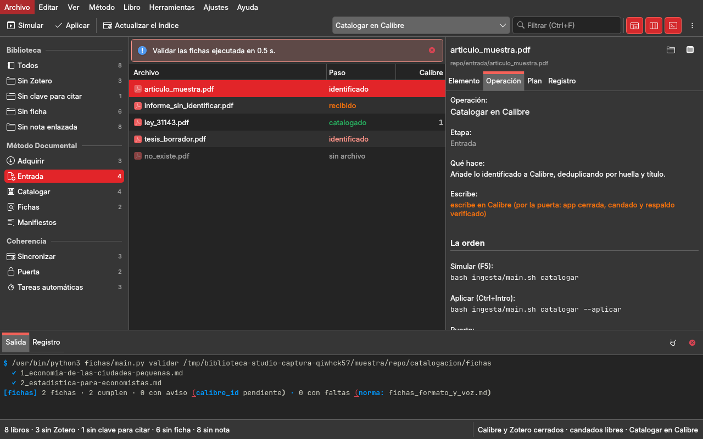
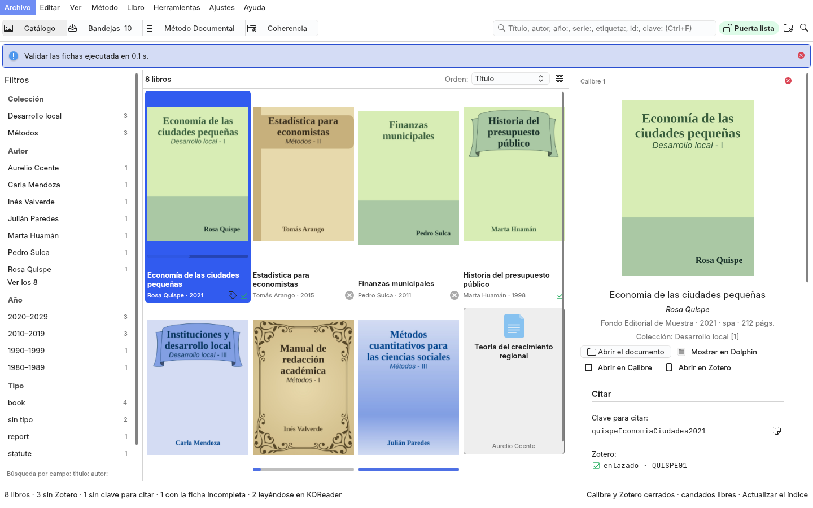
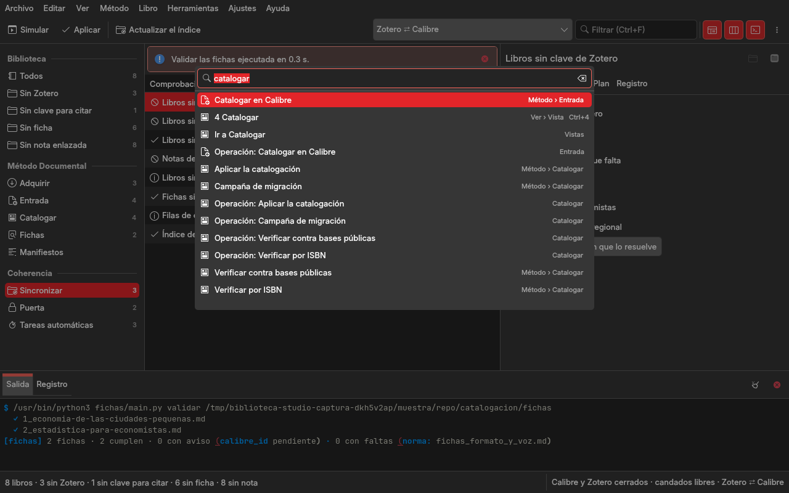

# Rediseño de Biblioteca Studio: la biblioteca, el Método Documental y la coherencia Calibre ⇄ KOReader ⇄ Zotero en una ventana de trabajo

Fase 5 de la modernización de la familia de studios (`gui-comun/docs/arquitectura-qml-kirigami.md` §8): Biblioteca
Studio es el quinto que sigue al piloto Git Studio, cuyo lenguaje visual y arquitectura de información
(`git-studio/docs/rediseno.md` §2, §4, §6, §8) el autor aprobó el 2026-11-01 «para todos los programas de la
familia». Filesystem, Dotfiles, Huella y LaTeX mostraron cómo se aplica a un studio que orquesta herramientas de
terminal: una ventana, una operación que corre en el panel inferior con progreso y cancelación, lo que escribe se
simula antes (F5) y se aplica tras confirmar (Ctrl+Intro). Este documento aplica ese diseño a este studio: la
auditoría de lo que hay (§1), las ocho preguntas de producto (§2), la arquitectura de información (§3), la ventana
(§4), lo construido (§5), los componentes (§6), lo que el marco necesitó (§7) y las decisiones (§8). **Está
construido** (rama `wip/2026-11-02-qml`, 2026-11-02): las capturas de §5 son reales; pasa a `hecho` cuando el autor
valide el studio en la sesión real (`../estado.md`).

Tres reglas condicionan todo lo demás. **Una sola puerta de escritura** (`../CLAUDE.md`, `decisiones.md` §2.5 y
§2.10): la ventana no escribe por su cuenta en `metadata.db` ni en `zotero.sqlite`; corre la CLI de cada suite, que
pasa por `lib/escribir.*` con la aplicación cerrada, candado y respaldo verificado. **Simular antes de escribir**
(regla 3 del workspace): F5 corre la orden sin `--aplicar`; Ctrl+Intro añade `--aplicar` tras confirmar, y no se
ofrece si Calibre o Zotero están abiertos o el candado está ocupado. **Zotero manda en citas y metadatos y Calibre
en los archivos** (§1.6): la ventana no decide nada de eso; lo deciden las suites.

## 1. Auditoría de la GUI actual (Widgets, `gui-comun` 1.1)

Ocho páginas en una barra lateral con la marca «Biblioteca Studio · Calibre · Zotero · KOReader» (el módulo ventana.py de
1.x, retirado en esta fase; se lee en la historia de git, commit 11372ff), construidas a mano con
`gui_comun.widgets`: tarjetas, cifras, listas con vacío, consola como cajón, paleta Ctrl+K, avisos. La lógica está
separada en el módulo acciones.py de 1.x (sin Qt: el catálogo de las 32 operaciones con su orden, su bandera
de aplicar, lo que piden y en qué base escriben; `abiertas()` y `candado_ocupado()`), que esta fase conserva como
servicio (`studio/biblioteca_app/servicios/operaciones.py`) y amplía con consultas.

| página | qué hace hoy | entidades y operaciones | lógica separada | mezclado en la ventana |
|---|---|---|---|---|
| Inicio | cuatro cifras del índice (libros, con Zotero, con ficha, fecha del índice), la tarjeta «Ahora mismo» (Calibre y Zotero abiertos o cerrados, candados) y un buscador de libros con resultados en lista (doble clic abre el libro) | libro (índice), puerta | `lib/indice.py` (solo lee las bases) | la búsqueda, el recuento, el pintado de la lista; es un panel de control |
| Entrada · Adquirir · Catalogar y verificar · Sincronizar · Fichas y lecturas · Manifiestos | una tarjeta por operación con su descripción, el campo de entrada si lo pide (texto, carpeta o archivo con «…») y los botones Simular y Aplicar (o Ejecutar); Aplicar pregunta con `QMessageBox` y se apaga con la aplicación de la base abierta (reloj de 4 s) | operación (32), puerta | el catálogo de 1.x (la orden exacta de cada una) | el `QFileDialog`, la confirmación sin mostrar la orden, el estado de la puerta por reloj, el worker; ninguna tarjeta dice qué hay por ingerir, por catalogar o sin enlazar: la operación se corre a ciegas |
| el libro (sin fila en la barra; lo abren los complementos con `biblioteca-studio://libro/<id>`) | portada, título, autores, claves (Calibre, Zotero, clave para citar), si hay nota, las fichas que lo citan (doble clic abre); Abrir en Calibre, en Zotero, el archivo, la nota, copiar la clave | libro, ficha, nota | `lib/indice.py` | los enlaces `calibre://show-book` y `zotero://select`, la lectura del índice |
| Puerta | candados y aplicaciones, los respaldos de cada escritura por suite (doble clic abre la carpeta) con el texto de cómo deshacer, y los timers (`systemctl --user list-timers` filtrado) | puerta, respaldo, timer | — | todo: la lectura de `$RESPALDOS_DIR/biblioteca/puerta/`, el filtrado de `systemctl` |

Lo que falta hoy: la ventana **no muestra los datos** sobre los que opera (qué archivos hay en la zona de entrada y
en qué paso va cada uno, qué filas de `resumen_catalogacion.tsv` aplicaría la catalogación, qué fichas hay y cuáles
están verificadas, qué proyectos tienen `fuentes.yml`, qué libros no están enlazados con Zotero o no tienen clave
para citar): cada operación se lanza sin ver su objeto. La salida de la simulación **se pierde** al correr otra
cosa (solo vive en la consola); no hay registro de la última aplicación de cada operación. La confirmación de
Aplicar no dice la orden ni las bases que va a tocar. Los timers se ven como texto crudo de `systemctl`. Preferencias:
solo `ui/tema`, que en 2.x no hace nada (el tema es del escritorio). El lanzador instalado apunta al Python de
Anaconda, que no carga Kirigami.

## 2. Las ocho preguntas de producto

1. **Tarea principal**: llevar un documento por el Método Documental (adquirir → ingerir → catalogar → fichar →
   citar) y mantener coherentes Calibre, KOReader y Zotero, corriendo cada paso **primero en simulación y después
   de verdad**, con la salida íntegra a la vista y sin escribir nunca fuera de la puerta. El sujeto es la
   **operación** de una etapa (sobre los datos de esa etapa); los verbos son Simular y Aplicar.
2. **Información constante**: cuántos libros hay y cuántos piden atención (sin Zotero, sin clave para citar, sin
   ficha, sin nota enlazada); si Calibre y Zotero están abiertos y si los candados están libres (de eso depende
   poder aplicar); qué operación está elegida y si hay una corriendo. → la **barra de estado** (contadores de
   coherencia a la izquierda; aplicaciones, candados y operación a la derecha; el progreso en medio).
3. **Acciones más frecuentes**: simular la operación elegida (F5), aplicarla (Ctrl+Intro), cancelar (Esc),
   actualizar el índice, abrir un libro en Calibre o en Zotero, buscar un libro. → **la barra**: Simular · Aplicar ·
   la operación de la etapa (lista desplegable) · el filtro.
4. **Lo que permanece visible**: la tabla de la vista activa y la barra de estado. Navegación, detalles y salida se
   pliegan.
5. **Operaciones contextuales**: sobre un libro, abrir en Calibre, en Zotero, el archivo, la nota, copiar la clave;
   sobre un archivo de la entrada, una ficha, un informe o un respaldo: abrir, abrir su carpeta, copiar la ruta.
   → **menú contextual y panel de detalles.**
6. **Solo cuando se pide**: qué hace exactamente una operación y con qué orden; el plan de su última simulación y
   el registro de su última aplicación; la ficha de un libro y las fichas que lo citan; el detalle de una fila
   (todos los campos del ledger); los respaldos de la puerta; las tareas automáticas. → **panel de detalles**
   (Elemento · Operación · Plan · Registro) y las vistas de Coherencia.
7. **Una sesión completa**: abrir → la barra de estado ya dice «1 234 libros · 118 sin Zotero · 96 sin clave · 300
   sin ficha» y «Calibre cerrado · Zotero cerrado · candados libres» → Método Documental › Entrada: la tabla lista
   los archivos de la zona de entrada con su paso (recibido, identificado, catalogado) → se elige «Catalogar en
   Calibre» en la lista de la barra (o en el menú Método) → F5: la salida de `ingesta/main.sh catalogar` corre en
   el panel inferior y queda en la pestaña Plan → se lee el plan → Ctrl+Intro: el diálogo muestra la orden exacta y
   «escribe en Calibre; Calibre está cerrado; el candado está libre» → Aplicar → la salida corre, al terminar la
   tabla de la entrada se relee y la fila pasa a «catalogado» → Biblioteca › Libros, el índice se actualiza (la
   operación de esa vista) y el libro nuevo aparece; se abre en Calibre desde el menú contextual.
8. **Tamaños**: como el piloto (§4.2 de su rediseño): bajo 900 px la navegación se pliega a iconos y los detalles se
   abren como hoja; las columnas secundarias de cada tabla se ocultan al estrecharse.

## 3. Arquitectura de información

### 3.1 Nueve vistas en tres secciones, una operación actual, una ventana

Las ocho páginas desaparecen como páginas. Hay **nueve vistas** del centro, elegidas en el panel de navegación en
tres secciones: **Biblioteca** (Libros, con sus filtros de coherencia), **Método Documental** (Adquirir, Entrada,
Catalogar, Fichas, Manifiestos: una por etapa que toca archivos) y **Coherencia** (Sincronizar, Puerta, Tareas
automáticas). Cada vista muestra en el centro **la tabla de lo que esa etapa maneja** y tiene **sus operaciones**:
la elegida es la **operación actual**, sobre la que actúan Simular (F5) y Aplicar (Ctrl+Intro) y de la que hablan
las pestañas Operación, Plan y Registro de los detalles.

| vista | centro (`TablaDatos`) | operaciones (las de hoy, la misma CLI) | detalles |
|---|---|---|---|
| **Libros** (Biblioteca; filtros: Todos · Sin Zotero · Sin clave para citar · Sin ficha · Sin nota enlazada) | los libros del índice (`lib/indice.py`): Título, Autores, Calibre (id), Zotero (clave), Clave para citar, Fichas (n), Nota (sí/no); filtrable por título, autor, clave o id | Actualizar el índice (`lib/indice.py`; F5 cuenta, Ctrl+Intro escribe el JSON) | **Libro**: Resumen (portada, título, autores, claves, formatos, nota; Abrir en Calibre · en Zotero · el archivo · la nota · Copiar la clave) · Fichas (las que lo citan; Intro abre) · Operación · Plan · Registro |
| **Adquirir** (Método Documental) | el ledger de descargas (`fuentes_descargadas.tsv`): Fecha, Fuente, Referencia, Título, Archivo, Estado | ¿Ya está en la biblioteca? · Fuentes disponibles · Localizar en una fuente · Descargar · Estado de lo descargado (`main.py`) | Elemento (todos los campos de la fila) · Operación · Plan · Registro |
| **Entrada** | los archivos de la zona de entrada (`entrada/`) cruzados con los ledgers (`ingesta/pendientes.tsv`, `ingesta/ingesta.tsv`): Archivo, Paso (recibido · identificado · catalogado, con color semántico), Título identificado, Confianza, Calibre (id) | Estado de la entrada · Recibir · Identificar · Catalogar en Calibre · Exportar a Zotero · Archivar · OCR de los escaneados · Todo el recorrido (`ingesta/main.sh`) | Elemento (la fila, la ficha provisional si existe) · Operación · Plan · Registro |
| **Catalogar** | las filas de `catalogacion/resumen_catalogacion.tsv`: Calibre (id), Autores, Título, Tipo, Fecha, Confianza, Ficha (sí/no) | Aplicar la catalogación (`catalogacion/main.sh`) · Verificar contra bases públicas · Verificar por ISBN (`verificacion/main.sh`) · Campaña de migración (`migraciones/main.py`) | Elemento (la fila; la ficha canónica si existe) · Operación · Plan · Registro |
| **Fichas** | las fichas canónicas (`catalogacion/fichas/*.md`): Ficha, Calibre (id), Título, Proyecto, Verificación (pendiente · verificada · observada, con color) | Validar las fichas · Estado de las fichas · Verificar textuales y paráfrasis (`fichas/main.py`) · Pasajes por concepto (`lecturas/main.py`) | Elemento (la ficha, `VistaTexto` en Markdown) · Operación · Plan · Registro |
| **Manifiestos** | los proyectos con `fuentes.yml` en las raíces vigiladas (`manifiesto.manifiestos_en()`): Proyecto, Carpeta, Entradas, Sin libro | Todos los fuentes.yml · Verificar un proyecto · Generar el de un proyecto · Bibliografía de un proyecto (`manifiesto/main.py`) | Elemento (el `fuentes.yml`, `VistaTexto`) · Operación · Plan · Registro |
| **Sincronizar** (Coherencia) | las comprobaciones de coherencia calculadas del índice y de los ledgers, sin correr nada: libros sin clave de Zotero, sin clave para citar, sin ficha, notas de lectura sin enlazar (`enlazar_notas.pendientes`), fichas sin libro, filas catalogadas sin ficha; cada una con su recuento, nivel y la operación que la resuelve | Zotero ⇄ Calibre · KOReader → Calibre · Tiempo de lectura de Zotero · Enlazar con Zotero lo que falta · Enlazar las notas de lectura · Metadatos en los PDF | Elemento (la comprobación y los primeros afectados) · Operación · Plan · Registro |
| **Puerta** | los respaldos de cada escritura (`$RESPALDOS_DIR/biblioteca/puerta/<suite>/`, o el estado de usuario sin el SSD): Suite, Respaldos, Último, Carpeta; Intro abre la carpeta | (ninguna: la puerta la abren las suites) | Elemento (candados y aplicaciones, cómo deshacer) |
| **Tareas automáticas** | los tres timers de usuario (`systemctl --user list-timers --output=json` y `show`): Unidad, Activo, Próxima, Última, Resultado; y si lo instalado coincide con las plantillas (`systemd/instalar.sh --verificar`) | Verificar las tareas automáticas (`--verificar`) · Instalar las tareas automáticas (`instalar.sh`; Ctrl+Intro `--aplicar`) | Elemento (la unidad) · Operación · Plan · Registro |

**Inicio** se reparte: las cifras van a la **barra de estado** y a los **contadores de la navegación** (los
filtros de Libros llevan su número); la búsqueda es el **filtro** de la vista Libros; «Ahora mismo» es el contexto
de la barra de estado. Las seis páginas de tarjetas son las **operaciones** de cada vista: se eligen en la lista de
la barra de herramientas, en el menú **Método** (un submenú por etapa) o en la paleta, y se corren con F5 y
Ctrl+Intro. **El libro** es la fila de Libros con sus detalles (el enlace `biblioteca-studio://libro/<id>` de los
complementos la selecciona). **Puerta** se divide en dos vistas de Coherencia. La ventana gana lo que no tenía: las
**tablas de datos** de cada etapa, las **comprobaciones de coherencia** sin correr nada, el **plan** y el **registro**
de cada operación conservados, y la confirmación que dice **la orden exacta y las bases que toca**.

### 3.2 Entidades y dónde vive cada dato

| entidad | datos | dónde |
|---|---|---|
| Libro (`lib/indice.py` → `$XDG_STATE_HOME/biblioteca/indice.json`; solo lectura de las bases) | `calibre_id`, título, autores, carpeta, formatos, clave de Zotero, clave para citar, apuntes, nota, fichas | tabla Libros (con los filtros de coherencia); detalles › Resumen y Fichas; contadores de la navegación y de la barra de estado |
| Operación (`studio/biblioteca_app/servicios/operaciones.py`: id, título, descripción, orden, bandera de aplicar, bases en las que escribe, lo que pide) | la orden exacta en simulación y al aplicar; en qué base escribe (Calibre, Zotero, ninguna); si pide texto, carpeta o archivo; lo escrito la última vez (`QSettings`) | lista de la barra; menú Método; detalles › Operación (descripción, orden, bases, entrada con `CampoRuta`; Simular y Aplicar al pie); contexto de la barra de estado |
| Corrida (`gui_comun.tareas.proceso`) | la orden, su salida línea a línea, el código de salida, la duración | panel inferior (Salida); barra de estado (tarea en curso, Esc cancela); al terminar, la tabla de la vista se relee |
| Plan y Registro (un archivo por operación y clase en la caché del studio, §8 B7) | la salida íntegra de la última simulación (Plan) y de la última aplicación (Registro), con fecha y código | detalles › Plan y Registro (`VistaTexto`) |
| Archivo de la entrada (`entrada/`, `ingesta/pendientes.tsv`, `ingesta/ingesta.tsv`, leídos por `lib/rutas.py`) | ruta, tamaño, paso (recibido · identificado · catalogado), título y confianza identificados, `calibre_id`, ficha provisional | tabla Entrada; detalles › Elemento |
| Descarga (`fuentes_descargadas.tsv`) · Fila de catalogación (`catalogacion/resumen_catalogacion.tsv`) · Ficha (`catalogacion/fichas/*.md`, frontmatter) · Proyecto (`fuentes.yml`) | los campos del ledger; de la ficha: `calibre_id`, `proyecto`, `verificacion.estado`; del proyecto: entradas, sin libro | tablas Adquirir, Catalogar, Fichas, Manifiestos; detalles › Elemento (el `.md` o el `.yml` en `VistaTexto`) |
| Comprobación de coherencia (calculada del índice y los ledgers) | nombre, recuento, nivel (positivo si 0; neutro o negativo si no), la operación que la resuelve, los primeros afectados | tabla Sincronizar; detalles › Elemento; la barra de estado (resumen) |
| Puerta (`core/env.py`: `LOCK_CALIBRE`, `LOCK_ZOTERO`; `/proc` para los procesos; la regla de `lib/escribir.py`) | Calibre y Zotero abiertos o cerrados; candados libres u ocupados; respaldos por suite (cuántos, el último) | contexto de la barra de estado (cada 4 s); la disponibilidad de Aplicar; tabla Puerta |
| Tarea automática (`systemctl --user`; `systemd/instalar.sh --verificar`) | unidad, activa, próxima, última, resultado, instalada = plantilla | tabla Tareas automáticas |
| Preferencias (`QSettings`) | la última vista, la última operación por vista, lo escrito en cada entrada | se recuerdan entre sesiones |

### 3.3 Dónde vive cada operación

Toda operación existe una sola vez, en `Acciones` (`studio/biblioteca_app/aplicacion.py`), y aparece en los lugares
de la tabla. Las 34 operaciones de las suites son acciones `op.<id>` que **eligen** la operación actual (y llevan a
su vista); correrla es siempre `op.simular` o `op.aplicar`.

| operación | menú | barra | contextual | detalles | paleta | atajo |
|---|---|---|---|---|---|---|
| Ir a cada vista (Libros · Adquirir · Entrada · Catalogar · Fichas · Manifiestos · Sincronizar · Puerta · Tareas) | Ver › Vista | | | | ● | Ctrl+1 … Ctrl+9 |
| Elegir una operación (34: una por tarjeta de hoy, más Verificar e Instalar las tareas automáticas) | Método › la etapa | ● (lista desplegable de las de la vista) | | | ● | |
| Simular (o Ejecutar, si la operación no escribe) la operación actual | Método | ● | | ● (Operación) | ● | F5 |
| Aplicar la operación actual (muestra la orden, las bases y el estado de la puerta; confirma) | Método | ● | | ● (Operación) | ● | Ctrl+Intro |
| Cancelar la operación | Método | (barra de estado) | | | ● | Esc |
| Actualizar el índice (la operación de la vista Libros) | Método › Biblioteca | | | | ● | Ctrl+R |
| Abrir en Calibre · Abrir en Zotero · Abrir el archivo · Nota de lectura · Copiar la clave (del libro actual) | Libro | | ● (Libros) | ● (Resumen) | ● | Ctrl+Mayús+C (clave) |
| Abrir · Abrir su carpeta · Copiar ruta (de la fila seleccionada: archivo, ficha, manifiesto, respaldo) | Archivo | | ● | ● (Elemento) | ● | Intro · Ctrl+Mayús+O |
| Abrir la zona de entrada en Dolphin · Abrir terminal en el repo | Archivo | | | | ● | Mayús+F4 |
| Filtrar · Seleccionar todo | Editar | ● (campo) | | | ● | Ctrl+F · Ctrl+A |
| Releer la vista (los ledgers, las fichas, los timers; el índice no se regenera) | Ver | | ● | | ● | F6 |
| Paneles · pantalla completa | Ver | ● | | | ● | F9 · F11 · F4 · Ctrl+Mayús+F |
| Paleta de órdenes | Herramientas | | | | — | Ctrl+Alt+I · Ctrl+K |
| Instalar el acceso directo (`install.sh`) | Herramientas | | | | ● | |
| Configurar Biblioteca Studio… | Ajustes | | | | ● | Ctrl+Mayús+, |
| Manual · Acerca de | Ayuda | | | | ● | F1 |

Reglas: **F5 nunca escribe en una base** (la orden va sin `--aplicar`; las operaciones que no tienen simulación
porque solo leen o solo escriben archivos del repo, como «Estado de la entrada» o «Descargar», se ejecutan con F5 y
no tienen Aplicar). **Ctrl+Intro** exige la confirmación con la orden exacta y las bases que toca, y está
deshabilitada mientras corre una tarea, si la aplicación de la base está abierta o si el candado está ocupado (la
puerta lo volvería a comprobar y saldría 75: la ventana lo dice antes). La paleta ofrece, además de las órdenes, cada
libro del índice («Libro: …» lo selecciona) y cada operación («Operación: …»).

## 4. Distribución de la ventana (1280 × 800)

```text
┌ Entrada — Biblioteca Studio ───────────────────────────────────────────────────────────── (KWin) ┐
│ Archivo  Editar  Ver  Método  Libro  Herramientas  Ajustes  Ayuda                                 │ menú
│ ▶ Simular  ✓ Aplicar │ [Catalogar en Calibre          ▾] [Filtrar (Ctrl+F)]            ▯▯▯ ⋯ │ barra
├──────────────┬──────────────────────────────────────────────────────┬───────────────────────────┤
│ BIBLIOTECA   │ Archivo                 Paso           Título     Conf│ Catalogar en Calibre  ▯ ▯ │
│ ▸ Libros 1234│▌ley_31143.pdf           ● identificado  Ley N.° … alta│ Entrada · ingesta/main.sh │
│   Sin Zotero │ informe_bcrp_2025.pdf   ● recibido      —          —  │ Elemento Operación Plan Registro │
│   Sin clave  │ tesis_quispe.pdf        ● catalogado    Tesis …   alta│ Añade lo identificado a   │
│   Sin ficha  │                                                      │ Calibre, deduplicando por │
│ MÉTODO DOC.  │                                                      │ huella y título.          │
│   Adquirir   │                                                      │ Orden: bash ingesta/main… │
│ ▸ Entrada  28│                                                      │ Escribe en: Calibre       │
│   Catalogar  │                                                      │ Calibre cerrado · libre   │
│   Fichas  936│                                                      │                           │
│   Manifiestos│                                                      │   [Simular]  [Aplicar]    │
│ COHERENCIA   │                                                      │                           │
│   Sincronizar│                                                      │                           │
│   Puerta     │                                                      │                           │
│   Tareas     │                                                      │                           │
├──────────────┴──────────────────────────────────────────────────────┴───────────────────────────┤
│ Salida │ Registro                                                                       ⌫  ✕     │ panel
│ $ bash …/ingesta/main.sh catalogar                                                               │ inferior
│ [simulación] 3 archivo(s) identificados · 1 ya en Calibre (huella) · 2 se añadirían              │ (F4)
├──────────────────────────────────────────────────────────────────────────────────────────────────┤
│ 1 234 libros · 118 sin Zotero · 96 sin clave · 300 sin ficha   Simulando… ▰▰▱   Calibre cerrado · Zotero cerrado · candados libres │
└──────────────────────────────────────────────────────────────────────────────────────────────────┘
```

Proporciones y comportamiento según el tamaño: los del piloto (`git-studio/docs/rediseno.md` §4). La navegación
pide 13 unidades; los detalles, 26 (la ficha en Markdown y el plan necesitan ancho); el panel inferior, 9 de alto.
Los tres divisores y los paneles se recuerdan en `QSettings`; la ventana se abre en la vista y con la operación de
la última vez.

## 5. Lo construido

Tres capturas reales (`studio/capturar.py`, 1280 × 800, el Qt del sistema con Kirigami 6.24, sin tocar el escritorio
ni las preferencias) sobre la **biblioteca de muestra** de `studio/muestra.py`: ocho libros ficticios creados con
`calibredb` en una carpeta temporal fuera de la carpeta de inicio, una `zotero.sqlite` mínima que enlaza cinco de
ellos (cuatro con clave para citar), los ledgers, dos fichas canónicas, una zona de entrada con cuatro archivos y un
`fuentes.yml`; el índice se genera con el mismo `lib/indice.py`. `HOME`, la configuración, la caché y el estado son
temporales, así que ninguna ruta de la máquina aparece en pantalla. Antes de capturar corre de verdad «Validar las
fichas» sobre las fichas de la muestra: la salida del panel inferior es la de la suite. En Lliphi Oscuro, la vista
Entrada (la zona de entrada cruzada con los ledgers: identificado, recibido, catalogado, sin archivo) con la operación
«Catalogar en Calibre» en la pestaña Operación (qué hace, que escribe en Calibre por la puerta, la orden de Simular y
la de Aplicar); en Lliphi Claro, la vista Libros con el Resumen de un libro (claves de Calibre, Zotero y para citar,
formatos, nota y fichas; Abrir en Calibre, en Zotero, el archivo); y la paleta de órdenes filtrando «catalogar»
(la vista, las operaciones del menú Método y las entradas «Operación: …»), sobre la vista Sincronizar.

| | |
|---|---|
|  |  |



Qué hay detrás: `studio/biblioteca_app/aplicacion.py` (el registro de acciones: §3.3 íntegro; las 34 operaciones como
`op.<id>` en un submenú por etapa; Simular se habilita con operación y sin tarea en curso, Aplicar solo si la operación
escribe, la aplicación de la base está cerrada y el candado libre; Cancelar al revés), seis controladores (`espacio`,
`libros`, `etapas`, `operaciones`, `puerta`, `ajustes`), tres servicios sin Qt (`operaciones`: el catálogo, con las
órdenes relativas al repo y las suites de Python por `CORE_PYTHON`; `puerta`: procesos, candados, respaldos, timers
por `systemctl --output=json`; `datos`: el índice, los ledgers por `lib/rutas.py`, las fichas por su frontmatter, los
manifiestos de las raíces vigiladas, las comprobaciones de coherencia), un módulo de modelos puros (las filas de las
nueve tablas) y `studio/biblioteca_app/qml/Main.qml` sobre `VentanaStudio` con seis componentes propios (ResumenLibro,
FichasLibro, Elemento, Operacion, Plan, Registro y el diálogo de ajustes). `lib/indice.py` y las suites no cambian;
los complementos «Ecosistema» tampoco. `tests/run.sh` con 32 pruebas: los servicios y los modelos (cada operación
corre un programa que existe, simular nunca lleva `--aplicar`, lo que escribe en una base lo declara; el candado; las
lecturas de la muestra; la coherencia), los controladores (vistas, filtros, el libro actual y el enlace de los
complementos, las tablas de etapa y el elemento, la puerta con Calibre «abierto», la operación actual con su entrada
recordada, simular de verdad `fichas/main.py validar` sobre la muestra y aplicar «Actualizar el índice» sobre la
muestra), la ventana entera, cada QML y `--smoke` con `/usr/bin/python3`, y las reglas de la familia (sin colores
propios, sin marca dentro, sin QtWidgets, sin SQL ni conexiones a las bases en el studio). **Ninguna prueba aplica una
suite que escriba en una base.** Lo que quedó fuera está en `../estado.md` §Por hacer.

## 6. Componentes

| región | componente | función |
|---|---|---|
| Barra de menú · barra de herramientas · barra de estado · paleta · «Acerca de» | `GuiComun.VentanaStudio` | las de la familia; en `herramientasExtra`, la lista desplegable de las operaciones de la vista (`QQC2.ComboBox`) y el filtro (Ctrl+F) |
| Navegación | `GuiComun.PanelNavegacion` | Biblioteca (Libros y sus filtros, con su número), Método Documental (Adquirir, Entrada, Catalogar, Fichas, Manifiestos, con su número) y Coherencia (Sincronizar, Puerta, Tareas automáticas) |
| Centro | `GuiComun.TablaDatos` (una por vista, `StackLayout`) sobre `gui_comun.modelos.ModeloTabla` + `ModeloFiltrado` | color semántico solo en Paso, Verificación, Estado y Resultado; menú contextual con las mismas acciones; Intro abre el elemento |
| Detalles | `GuiComun.PanelDetalles` con Elemento (`Kirigami.FormLayout` o `GuiComun.VistaTexto` en Markdown), Operación (formulario con `CampoRuta` o `TextField` para lo que pide; Simular y Aplicar al pie), Plan y Registro (`GuiComun.VistaTexto` monoespaciado); en Libros, Resumen (portada en `Image`, formulario, botones) y Fichas (`GuiComun.TablaDatos`) | todo lo del elemento seleccionado y de la operación actual |
| Panel inferior | `GuiComun.PanelInferior` | la salida de la CLI (Salida) y los eventos (Registro) |
| Diálogos | `Kirigami.PromptDialog` (Aplicar: la orden exacta, las bases, el estado de la puerta), `QtQuick.Dialogs` (`FileDialog` y `FolderDialog` desde `CampoRuta`), `GuiComun.DialogoAjustes` (General: la terminal) | lo que se pide y se cierra |
| Instancia única y esquema `biblioteca-studio://` | `QLocalServer` en Python (como hoy); el enlace selecciona el libro en la vista Libros | lo que piden los complementos |

## 7. Lo que el marco necesitó (`gui-comun` 2.4.0)

- **`PanelDetalles` conserva sus pestañas**: el modelo del `Repeater` de los botones pasa a ser el número de pestañas
  y cada botón lee la suya, así cambiar un contador o la visibilidad no recrea los botones (el `TabBar` de
  `org.kde.desktop` leía la altura del botón actual mientras se destruía y fallaba con «Cannot read property 'height'
  of null»); si la pestaña actual pasa a oculta, el panel salta a la primera visible. Este studio cambia la lista de
  pestañas por vista (el libro: Resumen y Fichas; una etapa: Elemento, Operación, Plan y Registro) y lo necesitaba.

Nada más: `VentanaStudio`, `PanelNavegacion`, `TablaDatos`, `PanelDetalles`, `PanelInferior`, `VistaTexto`, `CampoRuta`,
`ModeloTabla`, `ModeloFiltrado` y `Tareas.proceso` de 2.3 bastaron. Nada de `widgets/` se toca. La versión subió a
2.4.0 con CHANGELOG, la referencia de componentes y una prueba nueva; la etiqueta `v2.4.0` queda local hasta el visto
bueno del autor (rama `wip/2026-11-02-qml-biblioteca`).

## 8. Decisiones

| id | decisión | por qué |
|---|---|---|
| B1 | Nueve vistas en tres secciones (Biblioteca, Método Documental, Coherencia) con la tabla de lo que cada etapa maneja, y una operación actual por vista, en lugar de ocho páginas de tarjetas | el diseño aprobado de la familia: ningún panel de control; se opera viendo el objeto (qué hay por ingerir, por catalogar, sin enlazar), no a ciegas |
| B2 | F5 simula (la orden sin `--aplicar`; las que no escriben, se ejecutan) y Ctrl+Intro aplica tras un diálogo con la orden exacta, las bases que toca y el estado de la puerta; Aplicar se deshabilita con la aplicación de la base abierta o el candado ocupado | regla 3 del workspace; la puerta lo volvería a comprobar (salida 75): la ventana lo dice antes y no deja intentarlo |
| B3 | La ventana no escribe en ninguna base: cada operación es la CLI de su suite, la misma de la terminal, que pasa por la única puerta (`lib/escribir.*`) | `../CLAUDE.md`, `decisiones.md` §2.5 y §2.10: un escritor nuevo entra por la puerta o no existe; la ventana no es un escritor |
| B4 | La vista Libros lee el índice de `lib/indice.py` (el JSON), nunca `metadata.db` ni `zotero.sqlite`; «Actualizar el índice» es la operación de esa vista (F5 cuenta, Ctrl+Intro escribe el JSON) | el índice ya existe para los complementos y lo regenera el timer de KOReader cada 30 min; la ventana no abre las bases ni con Calibre abierto |
| B5 | Las tablas de etapa se leen de los ledgers tal cual (TSV por `lib/rutas.py`, las fichas por su frontmatter, los manifiestos por `manifiesto.manifiestos_en()`, los timers por `systemctl --output=json`), sin base propia ni caché | los ledgers son la verdad (`../CLAUDE.md`); lo que una suite escriba fuera de la ventana se refleja al releer (F6) |
| B6 | Lo que una operación pide (texto, carpeta, archivo) vive en la pestaña Operación de los detalles y se recuerda por operación en `QSettings` | la tarjeta de hoy lo pedía en el mismo sitio que los botones; la familia pone el formulario de la operación en los detalles (Filesystem, LaTeX) |
| B7 | El plan (última simulación) y el registro (última aplicación) de cada operación se guardan íntegros en la caché del studio, un archivo por operación y clase, y se muestran en los detalles | hoy la salida se pierde al correr otra cosa; la caché no entra en el repo ni en las suites (lo mismo que LaTeX Studio, L4) |
| B8 | Instancia única y el esquema `biblioteca-studio://libro/<id>` se conservan en Python (`QLocalServer`); el enlace selecciona el libro en Libros | lo piden los complementos de Calibre, KOReader y Zotero (§2.10), que no cambian |
| B9 | Las capturas y las pruebas corren sobre una biblioteca Calibre mínima creada con `calibredb add --empty` en una carpeta temporal (y saltan sin `calibredb`); nunca sobre la real; con `HOME` temporal | «las bases reales son intocables en las pruebas» (`../CLAUDE.md`); repo público: ninguna ruta de la máquina en las capturas |
| B10 | El studio corre con `/usr/bin/python3`; las suites de Python se invocan con `CORE_PYTHON` de `core/env.py` (el intérprete que ya usan los timers) y las de Bash con `bash` | el Qt del sistema es el que trae Kirigami; las suites no cambian de intérprete por la ventana |
| B11 | Lo sensible solo por estructura: la ventana lista `entrada/`, los ledgers, las fichas y los manifiestos de las raíces vigiladas (lo que las CLI ya imprimen); no muestra el contenido de las notas de lectura (las abre fuera, como hoy) ni lista carpetas de `sensibles:` de `meta/workspace.yml` | regla 8 del workspace: se mira el nombre, no el contenido |
