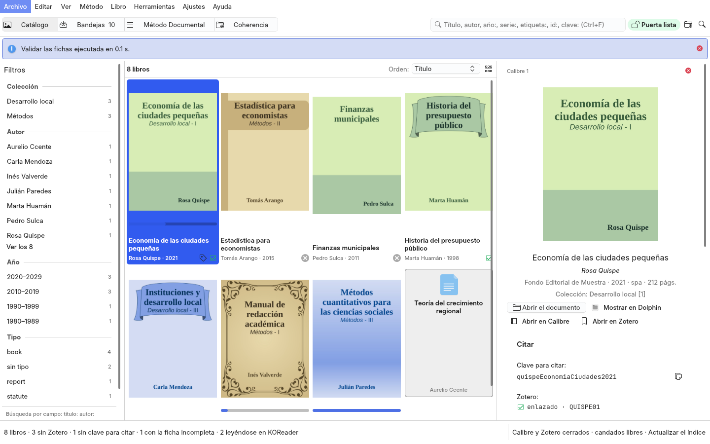
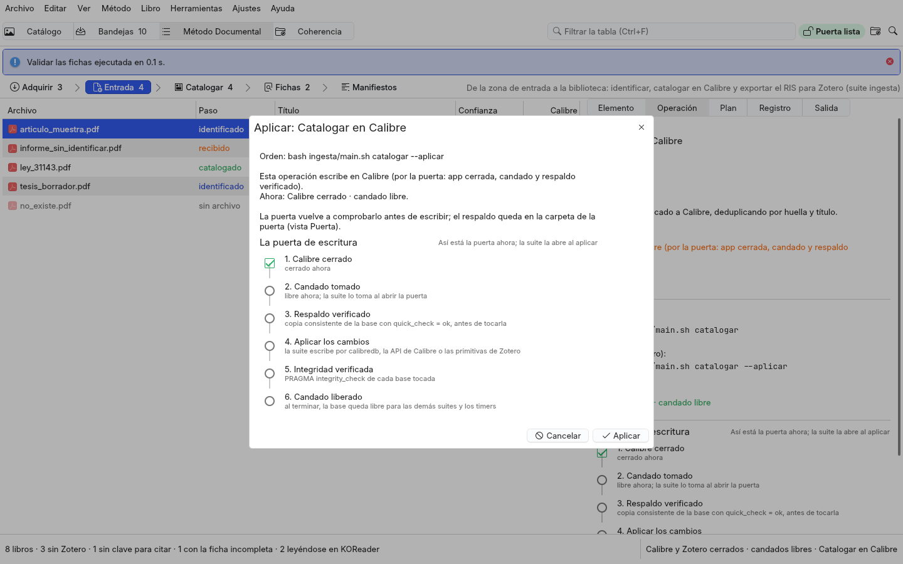

# studio/ — Biblioteca Studio, el gestor bibliográfico (QML + Kirigami sobre gui-comun 3.0) de la biblioteca: Calibre, Zotero y KOReader
<!-- suite:inicio -->
**Suite `biblioteca_studio`** · objetivo *biblioteca* · estado *activo* · python · interfaz gui

Gestor bibliográfico sobre la biblioteca de Calibre (QML + Kirigami sobre gui-comun 3.0): Inicio con lo de hoy; el catálogo con portadas, la búsqueda por campo y los filtros por colección, autor, año y tipo; la ficha editorial con la clave para citar, Zotero y la lectura; la base de lectura; las fichas de los escritos con su repaso Leitner; las etapas del Método Documental, la coherencia y las bandejas de trabajo. Cada operación es la CLI de su suite: F5 simula, Ctrl+Intro aplica tras confirmar, con los seis pasos de la puerta a la vista.

- Escribe en: calibre, zotero, archivos · simula por defecto: sí
- Depende de: /usr/bin/python3 con PySide6 del sistema (python3-pyside6.*) y Kirigami (qml6-module-org-kde-kirigami), {'gui-comun 3.0 (módulo QML GuiComun': 'VentanaBase, escritorio, estados de operación)'}, las suites de este repo (escriben por lib/escribir*, la puerta)
- Nota: No escribe por su cuenta en Calibre ni en Zotero ni abre sus bases (lo editorial lo lee lib/indice.editorial en solo lectura; las portadas, en miniatura a su caché); lo único que escribe es la base del repaso de las fichas (repaso.sqlite, REPASO_DB, por lib/repaso.py). Corre la CLI de cada suite, primero simulando (F5); «Aplicar» (Ctrl+Intro) confirma con la orden exacta y los pasos de la puerta, y se desactiva con Calibre o Zotero abiertos o el candado ocupado.

Comandos:

```bash
main.py
main.py biblioteca-studio://libro/48
main.py --smoke
install.sh
```

<sub>Bloque generado desde `suite.yml` por `core/suites.py generar` (2026-11-18); no se edita a mano.</sub>
<!-- suite:fin -->

## Qué es

Un gestor bibliográfico sobre la biblioteca de Calibre (`../docs/reingenieria.md`), en `VentanaBase` de `gui-comun` 3.0,
con siete áreas en chips (Ctrl+1–7: las seis del rediseño del 2026-11-18 y Revisión, `../docs/decisiones.md` §9.9 y §9.10) y Bandejas (Ctrl+8):



- **Inicio**: «Esto es lo de hoy». Cuatro cifras (leído esta semana, subrayados nuevos de los últimos siete días, fichas
  por revisar y pendientes de las bandejas), «Seguir leyendo» (hasta tres libros en curso, con la barra del color de la
  herramienta donde se leen) y «Siguiente paso» (fichar los subrayados sin ficha, el repaso del día, el escrito con
  fuentes nuevas en LaTeX Studio, las bandejas con algo). Lo que no tiene datos no se muestra.
- **Catálogo**: las portadas de Calibre en miniatura (o la lista compacta, Ctrl+G), con su orden y la barra de lectura
  de KOReader; la búsqueda (Ctrl+F) por palabras o por campo (`titulo:`, `autor:`, `año:2010` o `año:1990-2000`,
  `serie:`, `etiqueta:`, `id:` con el ISBN, el DOI o el número de Calibre, `clave:`); los filtros por colección (la serie),
  autor, década y tipo con sus cuentas (F9), y arriba la fila de los puestos, que se quitan de un toque; y la **ficha
  editorial** del libro: la portada, el título, el autor y el año, la clave para citar (Ctrl+Mayús+C), lo leído y los
  subrayados, «Abrir», «Nueva ficha», «Estudiar con la IA» y «Citar en LaTeX», «Usado en», Dolphin, Calibre y Zotero, y
  debajo su estado en Zotero, su lectura en KOReader, su nota, identificadores, etiquetas, descripción y fichas canónicas.
- **Lectura** (`../lectura_base/`, `../docs/decisiones.md` §9.6 y §9.8): la base de lectura única, en solo lectura. Arriba,
  subrayados, horas en doce semanas, libros con lectura y racha; la sincronización («Sincronizar ahora» y «Cada hora»);
  el total, este mes, las barras de las doce semanas y el mapa de calor por día; los libros con lectura; y del libro
  elegido (sigue al del catálogo) su progreso y su tiempo en KOReader, Zotero, Okular y Yachay, sus subrayados (con una
  raya del color de la herramienta donde nacieron, filtrados por origen; cada uno se copia como cita) y sus sesiones.
- **Fichas**: las de todos los escritos y las canónicas, filtradas en lista (Todas, Textuales, Paráfrasis, De obra, Por
  revisar, De la IA), cada una con su cita, su obra y página, si está cotejada con el PDF y si la propuso la IA, «Abrir en
  LaTeX Studio» y «Copiar la cita» (la de la IA, solo tras «Cotejé la página»: §9.10); «Nueva ficha» (también la ficha de
  obra, con sus seis preguntas) y «Estudiar con la IA»; y el **Repaso para estudiantes**: el sistema Leitner de cinco cajas (`../lib/repaso.py`,
  su base propia `repaso.sqlite`), con la pregunta, «Mostrar la ficha», «La sabía» y «Repasar luego».
- **Método** (Adquirir → Entrada → Catalogar → Fichas → Manifiestos, un recorrido de pasos con su contador) y
  **Coherencia** (cuatro tarjetas: Calibre ⇄ Zotero, Calibre ⇄ KOReader, Tareas automáticas y Referencias, si sus DOI e
  ISBN existen, §9.10; y Sincronizar, Puerta y
  Tareas automáticas): cada etapa con su descripción, «Simular» y «Aplicar» arriba, la tabla de lo que maneja (los
  ledgers, aquí sí, son tablas), el elemento elegido y sus operaciones, con su plan, su registro y la salida de la CLI.
- **Revisión** (Ctrl+7, `../lib/revision.py` y `../lib/prisma.py`, §9.10): la revisión de literatura de cada escrito, en
  su `<escrito>/fuentes/revision.yml`: el tipo de revisión y lo que exige, la pregunta y los criterios, la bitácora de búsqueda
  (base, cadena exacta, filtros, fecha, resultados; copiar la cadena, importar la exportación RIS o BibTeX), el cribado
  en dos fases con sus motivos y el diagrama PRISMA 2020 (`<escrito>/fuentes/prisma.pdf`, «Generar el diagrama»).
- **Bandejas** (Ctrl+8, desde Inicio, el menú Ver o la paleta): pendientes de clasificar (la zona de entrada sin
  catalogar y los libros sin tipo), fichas incompletas, sin clave para citar, sin Zotero y sin portada; cada una con lo
  que tiene y la operación que la vacía.

**La ventana no escribe en ninguna base de Calibre ni de Zotero, ni las abre.** Lo único que escribe es la base del repaso
(`$XDG_DATA_HOME/biblioteca/repaso.sqlite`, `REPASO_DB`), del usuario y por su único escritor, `../lib/repaso.py`, y, en los
escritos, la revisión (`<escrito>/fuentes/revision.yml` y `<escrito>/fuentes/prisma.*`) y el cotejo de una ficha (§9.10). Lo editorial lo lee `../lib/indice.py` (`editorial`, solo lectura)
y las portadas se leen en solo lectura y se guardan en miniatura en la caché del studio (`$XDG_CACHE_HOME/biblioteca-studio/portadas/`,
con tope). Cada operación es la CLI de su suite: **Simular (F5)**, la orden sin `--aplicar`; **Aplicar (Ctrl+Intro)**, con
`--aplicar` tras un diálogo con la orden exacta, las bases que toca y **los seis pasos de la puerta** (aplicación
cerrada, candado, respaldo verificado, aplicar, integridad, liberar). Los pasos los da `../lib/escribir.*` dentro de la
suite; la ventana los sigue en la salida y, al terminar, comprueba en solo lectura la integridad y el candado.



## Estructura

| archivo | qué es |
|---|---|
| `main.py` | el punto de entrada, sin lógica (`/usr/bin/python3`); una sola instancia (`QLocalServer`) |
| `biblioteca_app/aplicacion.py` | arma la aplicación: controladores, el proveedor de portadas (`gui_comun.miniaturas.ProveedorMiniaturas`, `image://portadas/<id>`), el registro de acciones (menú, paleta, atajos, estados de operación) y `biblioteca_app/qml/Main.qml` |
| `biblioteca_app/servicios/` | sin Qt: `catalogo` (une lo editorial al índice; búsqueda por campo, facetas, orden, bandejas), `pasos` (los seis pasos de la puerta vistos desde fuera), `operaciones` (el catálogo de órdenes), `puerta` (procesos, candados, respaldos, timers), `datos` (el índice, los ledgers, las fichas, los manifiestos, la coherencia) |
| `biblioteca_app/controladores/` | lo que QML ve: `espacio` (áreas, etapa, barra de estado, rutas), `libros` (el catálogo, la ficha, las bandejas), `etapas`, `operaciones` (la actual, Simular y Aplicar, plan, registro y pasos), `puerta`, `ajustes`, `lectura` (la base de lectura, solo lee), `fichas` (las fichas de los escritos y las canónicas, y el repaso), `inicio` (lo de hoy) |
| `biblioteca_app/qml/` | `Main.qml` sobre `GuiComun.VentanaBase` y `componentes/` (Inicio, Catalogo, TarjetaLibro, FilaLibro, PanelFiltros, FichaEditorial, Lectura, Fichas, EspacioEtapas, Operacion, Elemento, Plan, Registro, Bandejas; y las piezas Tarjeta, Cifra, BarraLectura y Chip) |
| `biblioteca_app/recursos/marca.svg` | el icono del lanzador: la única marca del studio |
| `muestra.py` | la biblioteca de muestra (libros ficticios con `calibredb`, metadatos y portadas por la API de Calibre, Zotero mínimo, ledgers y fichas) de las pruebas y las capturas; nunca la real |
| `capturar.py` | las capturas de la documentación sobre la muestra, con `HOME` temporal |
| `install.sh` | el acceso directo del menú y el esquema `biblioteca-studio://` (`gui_comun.lanzador`) |

## Uso

```bash
/usr/bin/python3 studio/main.py                               # desde biblioteca-studio/, en la sesión real
/usr/bin/python3 studio/main.py biblioteca-studio://libro/48   # abre el libro 48 (lo piden los complementos)
QT_QPA_PLATFORM=offscreen /usr/bin/python3 studio/main.py --smoke     # construye la interfaz y sale
studio/install.sh                                             # acceso directo en el menú y el esquema (con -n, simula)
/usr/bin/python3 studio/capturar.py docs/figuras/biblioteca-studio-oscuro.png --esquema <LliphiOscuro.colors> --libro 4
/usr/bin/python3 studio/capturar.py salida.png --area metodo --vista entrada --operacion catalogar --pestana 1 --dialogo
tests/run.sh                                                  # desde biblioteca-studio/: servicios, controladores, cada QML y --smoke sobre la muestra
```

Los complementos: `../calibre-plugin/`, `../koreader-plugin/`, `../zotero-plugin/` (no cambian con la ventana).

## Límite honesto

- **El catálogo se lee al abrir, con F6 o Ctrl+R y cuando `metadata.db` cambia** (Ver › Vigilar la biblioteca de Calibre,
  activado por omisión): un vigilante mira el archivo y su diario y, cuando Calibre o una suite dejan de escribir, relee
  en solo lectura como F6.
  Con una suite escribiendo, la base se lee como estaba confirmada (`immutable`) y la barra lo dice.
- **Los pasos de la puerta se deducen de la salida de la suite** (`── Backup:` y los `✗` de `lib/escribir.*`) y de dos
  comprobaciones de solo lectura al terminar; una suite que escribiera sin imprimir su respaldo saldría como «no abrió
  la puerta».
- **Las suites de Python corren con `CORE_PYTHON`** (`/usr/bin/python3`, el de los timers); la ventana nunca les presta el suyo.
- **La vista Manifiestos se lee al mostrarse** (recorre `escritura` y los datos crudos de `datafw`).
- **El plan y el registro se guardan por operación**, no por corrida; restaurar un respaldo sigue siendo a mano (Puerta).
