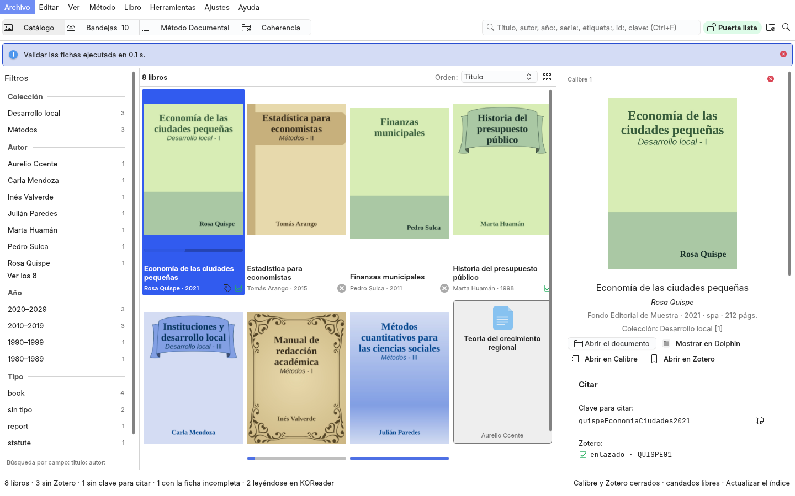
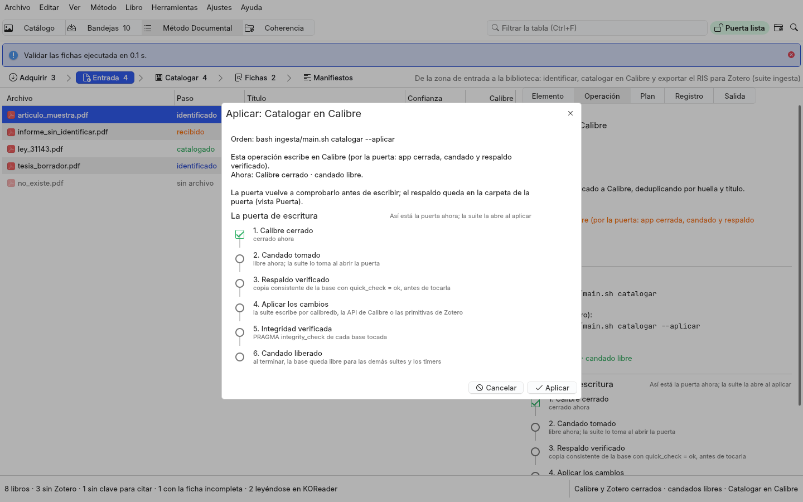

# studio/ — Biblioteca Studio, el gestor bibliográfico (QML + Kirigami sobre gui-comun 3.0) de la biblioteca: Calibre, Zotero y KOReader
<!-- suite:inicio -->
**Suite `biblioteca_studio`** · objetivo *biblioteca* · estado *activo* · python · interfaz gui

Gestor bibliográfico sobre la biblioteca de Calibre (QML + Kirigami sobre gui-comun 3.0): el catálogo con portadas, la búsqueda por campo y los filtros por colección, autor, año y tipo; la ficha editorial con la clave para citar, Zotero y la lectura de KOReader; las bandejas de trabajo; las etapas del Método Documental y la coherencia. Cada operación es la CLI de su suite: F5 simula, Ctrl+Intro aplica tras confirmar, con los seis pasos de la puerta a la vista.

- Escribe en: calibre, zotero · simula por defecto: sí
- Depende de: /usr/bin/python3 con PySide6 del sistema (python3-pyside6.*) y Kirigami (qml6-module-org-kde-kirigami), {'gui-comun 3.0 (módulo QML GuiComun': 'VentanaBase, escritorio, estados de operación)'}, las suites de este repo (escriben por lib/escribir*, la puerta)
- Nota: No escribe por su cuenta ni abre las bases (lo editorial lo lee lib/indice.editorial en solo lectura; las portadas, en miniatura a su caché): corre la CLI de cada suite, primero simulando (F5); «Aplicar» (Ctrl+Intro) confirma con la orden exacta y los pasos de la puerta, y se desactiva con Calibre o Zotero abiertos o el candado ocupado.

Comandos:

```bash
main.py
main.py biblioteca-studio://libro/48
main.py --smoke
install.sh
```

<sub>Bloque generado desde `suite.yml` por `core/suites.py generar` (2026-11-02); no se edita a mano.</sub>
<!-- suite:fin -->

## Qué es

Un gestor bibliográfico sobre la biblioteca de Calibre (`../docs/reingenieria.md`), en `VentanaBase` de `gui-comun` 3.0,
con cuatro áreas (Ctrl+1–4):



- **Catálogo**: las portadas de Calibre en miniatura (o la lista compacta, Ctrl+G), con su orden; la búsqueda (Ctrl+F)
  por palabras o por campo — `titulo:`, `autor:`, `año:2010` o `año:1990-2000`, `serie:`, `etiqueta:`, `id:` (ISBN, DOI
  o el número de Calibre), `clave:` —; los filtros por colección (la serie), autor, década y tipo con sus cuentas (F9); y
  la **ficha editorial** del libro: portada grande, pie de imprenta, serie, identificadores, etiquetas, descripción, la
  clave para citar (Ctrl+Mayús+C), su estado en Zotero, su lectura en KOReader, sus fichas y su nota; abrir el documento
  con su aplicación, mostrarlo en Dolphin, abrirlo en Calibre o en Zotero.
- **Bandejas**: pendientes de clasificar (la zona de entrada sin catalogar y los libros sin tipo), fichas incompletas,
  sin clave para citar, sin Zotero y sin portada; cada una con lo que tiene y la operación que la vacía.
- **Método Documental** (Adquirir → Entrada → Catalogar → Fichas → Manifiestos) y **Coherencia** (Sincronizar, Puerta,
  Tareas automáticas): cada etapa con la tabla de lo que maneja (los ledgers, aquí sí, son tablas), el elemento elegido y
  sus operaciones, con su plan, su registro y la salida de la CLI.

**La ventana no escribe en ninguna base ni la abre.** Lo editorial lo lee `../lib/indice.py` (`editorial`, solo lectura)
y las portadas se leen en solo lectura y se guardan en miniatura en la caché del studio (`$XDG_CACHE_HOME/biblioteca-studio/portadas/`,
con tope). Cada operación es la CLI de su suite: **Simular (F5)**, la orden sin `--aplicar`; **Aplicar (Ctrl+Intro)**, con
`--aplicar` tras un diálogo con la orden exacta, las bases que toca y **los seis pasos de la puerta** (aplicación
cerrada, candado, respaldo verificado, aplicar, integridad, liberar). Los pasos los da `../lib/escribir.*` dentro de la
suite; la ventana los sigue en la salida y, al terminar, comprueba en solo lectura la integridad y el candado.



## Estructura

| archivo | qué es |
|---|---|
| `main.py` | el punto de entrada, sin lógica (`/usr/bin/python3`); una sola instancia (`QLocalServer`) |
| `biblioteca_app/aplicacion.py` | arma la aplicación: controladores, el proveedor de portadas (`gui_comun.miniaturas.ProveedorMiniaturas`, `image://portadas/<id>`), el registro de acciones (menú, paleta, atajos, estados de operación) y `biblioteca_app/qml/Main.qml` |
| `biblioteca_app/servicios/` | sin Qt: `catalogo` (une lo editorial al índice; búsqueda por campo, facetas, orden, bandejas), `pasos` (los seis pasos de la puerta vistos desde fuera), `operaciones` (el catálogo de órdenes), `puerta` (procesos, candados, respaldos, timers), `datos` (el índice, los ledgers, las fichas, los manifiestos, la coherencia) |
| `biblioteca_app/controladores/` | lo que QML ve: `espacio` (áreas, etapa, barra de estado, rutas), `libros` (el catálogo, la ficha, las bandejas), `etapas`, `operaciones` (la actual, Simular y Aplicar, plan, registro y pasos), `puerta`, `ajustes` |
| `biblioteca_app/qml/` | `Main.qml` sobre `GuiComun.VentanaBase` y `componentes/` (Catalogo, TarjetaLibro, FilaLibro, PanelFiltros, FichaEditorial, Bandejas, EspacioEtapas, Operacion, Elemento, Plan, Registro) |
| `biblioteca_app/recursos/marca.svg` | el icono del lanzador: la única marca del studio |
| `muestra.py` | la biblioteca de muestra (libros ficticios con `calibredb`, metadatos y portadas por la API de Calibre, Zotero mínimo, ledgers y fichas) de las pruebas y las capturas; nunca la real |
| `capturar.py` | las capturas de la documentación sobre la muestra, con `HOME` temporal |
| `install.sh` | el acceso directo del menú y el esquema `biblioteca-studio://` (`gui_comun.lanzador`) |

## Uso

```bash
/usr/bin/python3 studio/main.py                               # desde biblioteca-studio/, en la sesión real
/usr/bin/python3 studio/main.py biblioteca-studio://libro/48   # abre el libro 48 (lo piden los complementos)
QT_QPA_PLATFORM=offscreen /usr/bin/python3 studio/main.py --smoke     # construye la interfaz y sale
studio/install.sh                                             # acceso directo en el menú y el esquema (con -n, simula)
/usr/bin/python3 studio/capturar.py docs/figuras/biblioteca-studio-oscuro.png --esquema <LliphiOscuro.colors> --libro 4
/usr/bin/python3 studio/capturar.py salida.png --area metodo --vista entrada --operacion catalogar --pestana 1 --dialogo
tests/run.sh                                                  # desde biblioteca-studio/: servicios, controladores, cada QML y --smoke sobre la muestra
```

Los complementos: `../calibre-plugin/`, `../koreader-plugin/`, `../zotero-plugin/` (no cambian con la ventana).

## Límite honesto

- **El catálogo se lee al abrir, con F6 o Ctrl+R y cuando `metadata.db` cambia** (Ver › Vigilar la biblioteca de Calibre,
  activado por omisión): un vigilante mira el archivo y su diario y, cuando Calibre o una suite dejan de escribir, relee
  en solo lectura como F6.
  Con una suite escribiendo, la base se lee como estaba confirmada (`immutable`) y la barra lo dice.
- **Los pasos de la puerta se deducen de la salida de la suite** (`── Backup:` y los `✗` de `lib/escribir.*`) y de dos
  comprobaciones de solo lectura al terminar; una suite que escribiera sin imprimir su respaldo saldría como «no abrió
  la puerta».
- **Las suites de Python corren con `CORE_PYTHON`** (`/usr/bin/python3`, el de los timers); la ventana nunca les presta el suyo.
- **La vista Manifiestos se lee al mostrarse** (recorre `escritura` y los datos crudos de `datafw`).
- **El plan y el registro se guardan por operación**, no por corrida; restaurar un respaldo sigue siendo a mano (Puerta).
